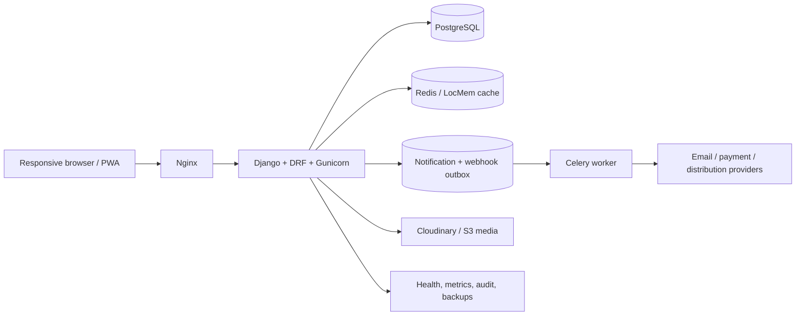

# Article Studio architecture

## Feature-to-technology mapping

| Product capability | Implementation |
| --- | --- |
| Editorial workflow | Django domain services, DRF workflow endpoints, role/capability checks |
| Multi-tenant newsroom | Workspace models, membership scope, workspace-aware querysets |
| Reliable notifications | Database delivery records, transactional outbox, Celery retries |
| Search and discovery | PostgreSQL filters/annotations, pagination, cache-backed public feeds |
| Media pipeline | Pillow variants, malware guard, Cloudinary/S3-compatible storage |
| Operations | Structured request logs, Prometheus metrics, health/status endpoints |
| Security | MFA, JWT/session auth, throttling, audit logs, CI dependency/secret scans |

The Docker Compose stack is the production reference; the Render profile is a
deliberately reduced interview preview with asynchronous providers disabled.
